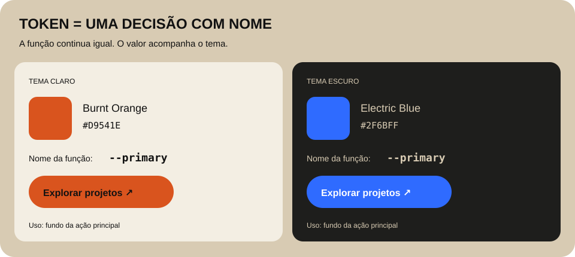

# Fundamentos visuais

[Mapa geral](../../DESIGN.md) · [Guia visual](https://midelim-portfolio-preview.creamgown2.chatgpt.site/design-system/)

## 1. Token: uma decisão com nome

Um token associa um nome a um valor de design. Exemplo: `primary` significa a cor da ação principal. O componente pergunta ao sistema qual valor usar.



| Camada | Exemplo | Significado |
| --- | --- | --- |
| Valor | `#2F6BFF` | Uma cor específica |
| Paleta | `--palette-electric-blue` | Nome da cor |
| Função semântica | `--primary` | Papel daquela cor na interface |
| Componente | `ActionLink` | Peça que usa a função |

Uma mudança na função afeta os componentes que a consultam. Não é necessário procurar cores repetidas em cada página.

## 2. Cores em execução

Fonte: [tokens.css](../../src/design/tokens.css).

| Token | Claro | Escuro | Uso |
| --- | --- | --- | --- |
| `--background` | Cream #F3EEE3 | Charcoal #1E1E1C | Fundo da página |
| `--surface` | #EBE5D8 | #242420 | Cartão lateral e superfícies |
| `--foreground` | Ink Black #111111 | Sand #D8CBB3 | Texto principal |
| `--muted-foreground` | #111111B3 | #D8CBB3B8 | Texto secundário |
| `--border` | #1111112B | #D8CBB333 | Divisórias e contornos |
| `--primary` | Burnt Orange #D9541E | Electric Blue #2F6BFF | Ação principal |
| `--primary-foreground` | Ink Black #111111 | Branco #FFFFFF | Texto da ação |
| `--portrait-background` | Sand #D8CBB3 | Sand #D8CBB3 | Fundo da foto |

Os dois últimos caracteres de uma cor com oito dígitos representam opacidade. Superfícies e transparências são variações neutras já existentes; não constituem uma nova paleta de destaque.

Azul e laranja identificam ações principais. Não espalhar essas cores em todos os títulos, ícones e cards. As capas ilustrativas usam os neutros do tema; a fotografia mantém suas próprias cores.

### Como usar

```tsx
<div className="bg-surface text-foreground border border-border">
  Conteúdo do cartão
</div>
```

```css
.exemplo {
  background: var(--surface);
  color: var(--foreground);
}
```

Aliases antigos preservados: `--bg → --background`, `--panel → --surface`, `--text → --foreground`, `--cta → --primary`. Evite introduzir novos aliases sem necessidade.

## 3. Temas

O tema inicial respeita o dispositivo. A escolha manual é salva no navegador. A alteração do sistema é acompanhada enquanto não houver escolha manual. Os parâmetros antigos de paleta continuam aceitos.

Os dois temas preservam a estrutura e o significado dos elementos. A demonstração local do guia usa `data-design-theme` para comparar amostras; ela não muda a preferência global.

## 4. Tipografia

| Nome | Fonte | Papel | Referência visual |
| --- | --- | --- | --- |
| `--font-heading` | Space Grotesk | Títulos e identidade | Frases grandes da Home |
| `--font-body` | DM Sans | Leitura e navegação | Parágrafos e menu |

Valores do site anterior preservados:

- Corpo: 16 px, entrelinha 1,65.
- Introdução: 18 px; 16 px no breakpoint de até 520 px.
- H1 da Home: base fluida entre 62 e 112 px, com ajustes específicos por breakpoint.
- H1 de páginas internas: base fluida entre 58 e 94 px, com ajustes em telas menores.
- H2: base fluida entre 35 e 64 px.
- H3 de card: 27 px.
- Identificadores e informações auxiliares: aproximadamente 9–12 px; revisar legibilidade no celular.

Esses valores descrevem a implementação atual, não uma escala final já normalizada. O guia reduz alguns espécimes para caber no catálogo. Use a hierarquia HTML conforme a estrutura do conteúdo, sem escolher H1/H2 apenas pelo tamanho visual.

## 5. Espaço e bordas

**Padding:** espaço interno. **Gap:** distância entre itens. **Margin:** espaço externo. **Radius:** arredondamento dos cantos.

Proposta de vocabulário para novas peças:

| Token | Valor |
| --- | --- |
| `--space-1` | 4 px |
| `--space-2` | 8 px |
| `--space-3` | 12 px |
| `--space-4` | 16 px |
| `--space-6` | 24 px |
| `--space-8` | 32 px |
| `--space-12` | 48 px |
| `--space-16` | 64 px |

A escala está disponível, mas sua adoção no layout completo está em revisão. Não arredondar automaticamente valores antigos de 25, 26, 34 ou 38 px.

Raios registrados: perfil 30 px, imagem 18 px, capa de projeto 23 px, ação principal 30 px. São decisões distintas com nomes próprios.

## 6. Layout responsivo

| Faixa atual | Comportamento |
| --- | --- |
| Mais de 1100 px | Coluna de perfil de 285 px; conteúdo ao lado |
| Até 1100 px, acima de 800 px | Perfil de 240 px e espaços reduzidos |
| Até 800 px | Perfil compacto no topo, com retrato de 58 × 70 px |
| Até 520 px | Cards e blocos principais em uma coluna |

Largura máxima da composição: 1660 px. Home longa e rotas internas independentes. O menu mantém a ordem definida. O guia tem regras próprias de responsividade para suas amostras.

## 7. Movimento

- Ações: transição de aproximadamente 250 ms.
- Cards: deslocamento discreto no hover, 400 ms.
- Entrada de elementos: opacidade e deslocamento de 24 px em 650 ms.
- Rolagem: suave nativa e barra de progresso.
- Preferência `prefers-reduced-motion`: remove animações e transições.

Não há GSAP, Lenis ou parallax implementados. Qualquer evolução deve conservar acesso ao conteúdo sem depender de animação.

## 8. Imagens

Retrato em `public/images/michel-marques.webp`: 640 × 801 px, com transparência. O fundo Sand é aplicado em CSS. Não alterar rosto, roupa ou cores em tarefas de layout.

As capas são ilustrações em CSS, não capturas dos projetos. Ao substituí-las por capturas reais, definir enquadramento, legenda e texto alternativo. Não apresentar dados, telas ou resultados fictícios.

## 9. Acessibilidade

Referência: [WCAG 2.2](https://www.w3.org/TR/WCAG22/). Para texto comum, revisar contraste mínimo de 4,5:1; para texto grande, 3:1 conforme a definição da norma. Esses limites não representam uma certificação do site.

Validar também foco visível, navegação por teclado, zoom, leitura das imagens e movimento reduzido. Texto sobre fotografia exige verificação específica. Rótulos pequenos e alvos móveis seguem como itens de revisão manual.
